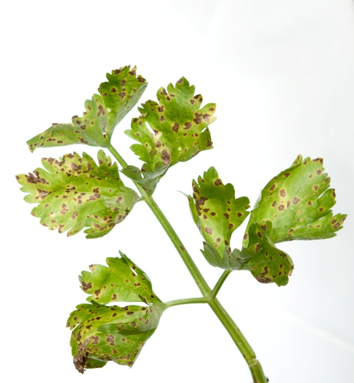
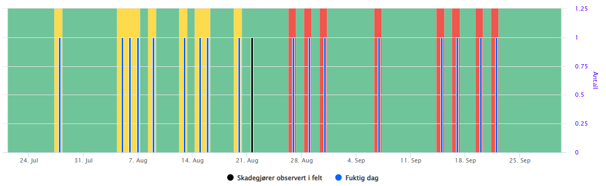

# Septoria apiicola model

This repository contains the implementation of the Bremia Lactucae model.

&copy; [NIBIO](https://nibio.no/en)

Contact person: [Berit Nordskog](https://nibio.no/en/employees/berit-nordskog)

This model calculates infection risk of Celery leaf spot (alt. Septoria late blight) (*Septoria apiicola*) using weather data and forecasts. The risk alerts apply to celery but are also relevant for parsley blight (*Septoria petroselini*) in parsley.  

In Norway, celery leaf spot occurs sporadically, and the model is recommended as a tool to help determine when to intensify field inspections prior to the first detection of symptoms.   



*Celery leaf spot in celery. (Photo:Erling Fløistad, NIBIO)*

The model for celery leaf spot is based on a calculation of when weather conditions are wet enough for the fungus to sporulate and cause infection in susceptible host plants.  

Infection risk alerts are issued when a minimum of 12 consecutive hours of leaf wetness is recorded. Wetness periods are calculated based on leaf wetness measured 30 cm above ground level. At weather stations without ground-level sensors, leaf wetness measured at 2 m is used. Weather data is obtained from weather stations affiliated with the Agrometeorological service ([Landbruksmeteorologisk Tjeneste (LMT)](https://lmt.nibio.no)) and from 2-day forecasts by the [Norwegian Meteorological Institute](https://met.no). 

## Interpretation of warnings 
Red alert means high risk of infection and symptoms of celery leaf spot have been reported from the area/region association with the current weather station. Yellow alert means the weather conditions indicate risk of infections, but there are no recorded symptoms in the area. Green means no estimated risk of infection.  

Model calculations are updated daily, based on observed weather data to present time and 2-day weather forecasts. Field observations and registration of celery leaf spot are carried out in collaboration with the Norwegian Agricultural Advisory Service.   



*Screenshot from detailed model outputs for celery leaf spot. Blue bars indicate periods of at least 12 consecutive hours of leaf wetness. Black bar indicates date of first field observation of Septoria leaf spot. Green, yellow and red background colors correspond to daily alert status on VIPSweb home page and in the table under detailed model outputs.*

## Season of model operation
Risk alerts are issued from weather stations in areas with celery production. In Norway, he model is active from June through September. 

## Test and validation of the model
The model is developed in Michigan, USA and published by Lacy (1994). In Norway, field trials with studies of weather conditions, spore formation and infection conditions were carried out at Ås during the period 2012-2016. The results showed that the model generally performs well, although its accuracy is slightly reduced during periods of rainfall (Nordskog and Le, 2014). 

## References
Lacy, M.L. 1994. Influence of wetness periods on infection of celery by Septoria apiicola and use in timing sprays for control. Plant Disease 78, 975-979.

Nordskog, B. and Le, V.H. 2015. Varsling av selleribladflekk [Forecast of celery late blight]. Gartneryrket nr 6, s14-15. (Norwegian text)

Celery leaf spot description: [Plantevernleksikonet](https://leksikon.nibio.no/l/oppslag/479/) (Norwegian only)


### Development

Clone Gitlab repository

```
$ git clone https://gitlab.nibio.no/VIPS/models/java/Model_SEPAPIICOL.git
$ cd Model_SEPAPIICOL
```

### Compile, run tests
```bash
mvn clean install
```

### Deploy to VIPSCore
See [the VIPSCore README](https://gitlab.nibio.no/VIPS/VIPSCore)
